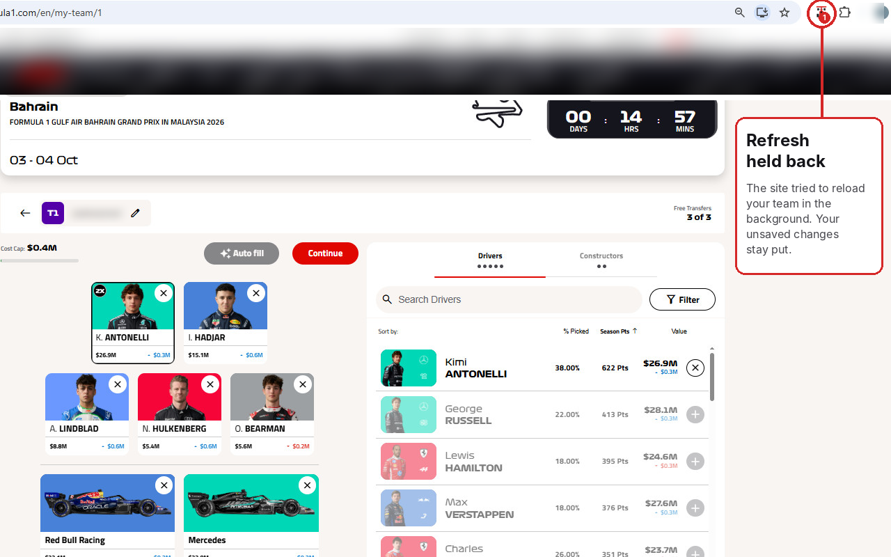

# Team Refresh Blocker for F1 Fantasy

A small Chrome extension that stops the F1 Fantasy website from resetting your team while you're in the middle of editing it.

> **Unofficial.** This extension is not affiliated with, endorsed by or connected to Formula 1, the FIA or the F1 Fantasy game.

## The problem

While you're making transfers on [fantasy.formula1.com](https://fantasy.formula1.com), the page sometimes snaps back to your saved team, wiping out the changes you haven't saved yet.

This happens because the site quietly re-downloads your saved team in the background (a request to `.../getteam/...`) and redraws the page with it.

## What this extension does

- When you open or reload the page, your team **loads exactly as normal**.
- After that, the site's **background** re-downloads of your team are blocked, so your unsaved changes stay put.
- When you **confirm changes**, the site is allowed to fetch your team again, so you see your newly saved team straight away.
- Moving to another screen in the site, such as switching to another of your teams, also loads normally.
- Click the race car icon in the toolbar to switch blocking **on or off**.
- The number on the icon shows how many background refreshes have been blocked on the current tab.

## Privacy and permissions

**This extension collects no data and sends nothing anywhere.** There are no analytics, no tracking and no external servers. All the code is in this repository, and nothing is downloaded from the internet.

| What it uses | Why |
| --- | --- |
| Runs on `fantasy.formula1.com` only | To see the site's own `getteam` requests and block the background ones. It does not run on any other website. |
| `storage` permission | To remember whether you've switched blocking on or off. That single on/off setting is the only thing stored, locally in your browser. |

See [PRIVACY.md](PRIVACY.md) for the full privacy policy.

## Install

Until it's available on the Chrome Web Store, you can install it manually. It takes about a minute.

1. Go to the [Releases](../../releases) page and download the latest `team-refresh-blocker-vX.X.zip`.
2. Unzip it. You should end up with a folder that has `manifest.json` directly inside it.
3. In Chrome, go to `chrome://extensions`.
4. Turn on **Developer mode** (switch in the top right).
5. Click **Load unpacked** and select the unzipped folder.
6. Optional: click the puzzle-piece icon in Chrome's toolbar and pin **Team Refresh Blocker for F1 Fantasy**, so you can see the counter.

Then open F1 Fantasy as usual. Blocking is on by default.

**Keep the unzipped folder** where it is. Chrome loads the extension from that folder, so if you delete or move it, the extension stops working.

Works in Chrome 111 or newer, and in other Chromium browsers such as Edge and Brave (the steps are the same; Edge's page is `edge://extensions`).

## Tips

- If something on the page ever looks out of date, reload the page. A reload always fetches your latest team.
- If anything doesn't behave as expected, untick **Blocking on** and reload to use the site as normal, and please [open an issue](../../issues).

## Updating

Manually installed extensions don't update automatically. To update:

1. Download the new zip from [Releases](../../releases) and unzip it.
2. On `chrome://extensions`, remove the old version.
3. Click **Load unpacked** and select the new folder.

Watch this repository (**Watch → Custom → Releases**) to be notified of new versions.

## Uninstall

Go to `chrome://extensions`, find **Team Refresh Blocker for F1 Fantasy** and click **Remove**. You can then delete the folder.

## How it works (for the curious)

The code is short and meant to be read. Everything is in the [`extension`](extension) folder:

| File | What it does |
| --- | --- |
| [`manifest.json`](extension/manifest.json) | Tells Chrome what the extension is, which site it runs on and which permission it uses (Manifest V3). |
| [`page.js`](extension/page.js) | Runs inside F1 Fantasy pages and watches the page's `fetch` and `XMLHttpRequest` calls. Team requests (`/getteam/`) are allowed when the page first loads your team, for a few seconds after you move to another screen in the site, and while a save (such as Confirm Changes) is in progress and for a few seconds after it succeeds. All other team requests are blocked: they fail straight away as if the connection had dropped, so the site keeps the team you're editing. |
| [`bridge.js`](extension/bridge.js) | Passes the on/off setting to `page.js`, and tells the extension when a request is blocked. |
| [`background.js`](extension/background.js) | Updates the counter on the toolbar icon. |
| [`popup.html`](extension/popup.html) / [`popup.js`](extension/popup.js) | The on/off checkbox you see when you click the icon. |

Feel free to check it yourself, or ask someone you trust to.

## Problems or ideas

Please [open an issue](../../issues). If the site changes and the extension stops working, an issue with what you saw is the quickest way to get it fixed.

## Licence

[MIT](LICENSE). Free to use, change and share.

Formula 1 and F1 are trademarks of their respective owners and are used here only to describe what the extension works with.
